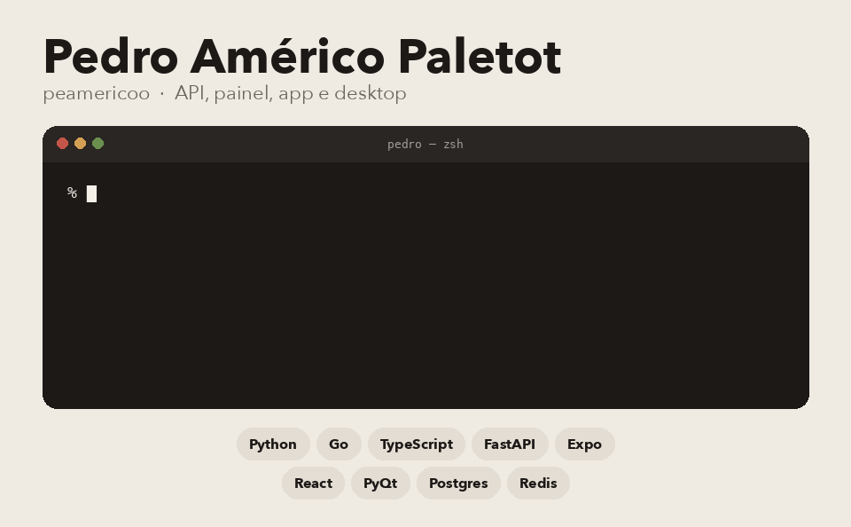

  

Eu pego o problema e monto o caminho inteiro. API, banco, fila e a tela. Se a tela for celular, vai de Expo. Se for janela de desktop, vai de PyQt.

## Onde olhar

- [Cori](https://github.com/peamericoo/Cori) é o consultório de psicologia. FastAPI, Postgres, Redis e o app em Expo.
- [BusquePet](https://github.com/peamericoo/BusquePet) procura animal perdido por foto. Go, Python, NATS e Redis.
- [InfraView](https://github.com/peamericoo/InfraView) mostra servidor no ar ou caído. PyQt5, ping e SQLite.
- [Compliance Gate](https://github.com/peamericoo/Compliance-Gate) tira a conformidade da planilha. FastAPI, Polars, DuckDB e React.
- [TicketSense](https://github.com/peamericoo/TicketSense-AI) classifica a intenção de um ticket. FastAPI e DistilBERT.
- [DevSetup Manager](https://github.com/peamericoo/Trabalho-Final-de-Programa-o-Web-I---DevSetupManager) é o inventário de TI da matéria. Flask e SQLite. O nome do repositório continua o da entrega.

O README de cada um diz o que já roda e o que ainda é canteiro.

Pedro Américo Paletot
